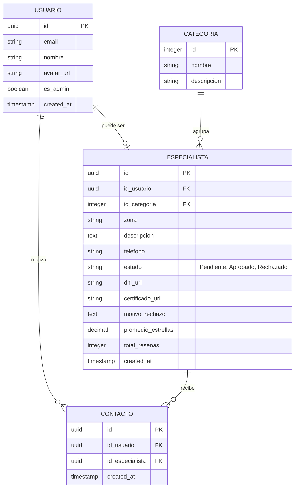

# Diseño de Base de Datos - FixYa

El esquema relacional garantiza la integridad referencial y permite la consulta de los especialistas aprobados por categoria.

## Reglas de Negocio (RLS - Row Level Security):
*   **Usuarios y rol Admin:** Cada USUARIO autenticado solo puede leer y editar sus propios datos basicos (`nombre`, `avatar_url`). La columna `es_admin` queda protegida tanto por permisos de columna (`GRANT UPDATE (nombre, avatar_url)`) como por clausula `WITH CHECK` para impedir auto-asignacion de privilegios de administrador.
*   **Especialistas y documentos:** Toda lectura publica, postulacion y aprobacion de ESPECIALISTA pasa por el backend BFF (`service_role`), evitando acceso anonimo directo o auto-aprobacion desde el cliente. El bucket `especialistas_docs` es privado y solo emite URLs firmadas temporales para administradores.
*   **Contactos:** Solo el backend BFF inserta registros en CONTACTO luego de validar que el especialista este aprobado, mientras que cada USUARIO autenticado unicamente puede consultar sus propios contactos.
